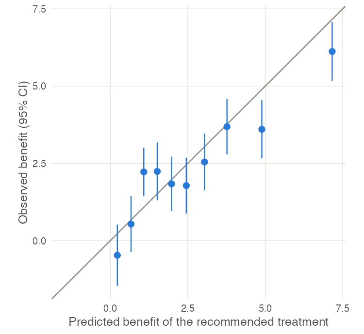

# cateval

<!-- badges: start -->

<!-- badges: end -->

**Check whether a treatment-selection model gives the right advice.**

A treatment-selection model predicts each patient's outcome on every
available treatment and recommends the one with the best prediction. cateval
checks those predictions against the outcomes patients had, using data you
already hold: the treatment each patient received, their outcome, and the
model's predictions.

It answers two questions:

- **Overall benefit.** Do patients who received the recommended treatment do
  better than similar patients who did not, and by as much as the model
  predicted?
- **Pairwise effects.** For each pair of treatments, do the observed
  differences match the predicted ones?

cateval works with any continuous outcome where lower is better, any number of
treatments and any naming scheme for your columns.

## Installation

```r
# install.packages("remotes")
remotes::install_github("PM-Cardoso/cateval")
```

## Example

The package includes `cateval_example`, a simulated cohort of 3000 patients
on three treatments.

```r
library(cateval)

# pair patients who received the recommended treatment with similar
# patients who did not
matched <- match_benefit_pairs(
  cateval_example,
  drug_var     = "treatment",
  outcome_var  = "outcome",
  pred_cols    = c("pred_A", "pred_B", "pred_C"),
  matching_var = c("age", "sex", "baseline", "marker"),
  seed         = 1
)

benefit_overall(matched$combined)          # average benefit of following the model
benefit_by_group(matched$combined, 10)     # observed vs predicted, in 10 groups
benefit_citl_slope(matched$combined)       # calibration in the large and slope
```

Plot the grouped results against the diagonal to compare predicted and
observed benefit:

<p align="center">
  
</p>

In this simulation the model ranks patients well, but overstates the largest
benefits. The [worked example](https://PM-Cardoso.github.io/cateval/articles/worked-example.html)
covers the full analysis, with the plotting code and the pairwise
comparisons.

## Functions

| Task                                               | Functions                                                                                                                 |
| -------------------------------------------------- | ------------------------------------------------------------------------------------------------------------------------- |
| Find the recommended treatment                     | `get_best_drugs()`, `plot_optimal_drugs()`                                                                            |
| Measure the benefit of following the model         | `match_benefit_pairs()`, `benefit_overall()`, `benefit_by_group()`, `benefit_citl_slope()`, `benefit_by_drug()` |
| Check the predicted differences between treatments | `pairwise_calibration()`, `pairwise_calibration_pair()`                                                               |

Full documentation: [https://PM-Cardoso.github.io/cateval/](https://PM-Cardoso.github.io/cateval/)

## Citation

```bibtex
@software{cardoso2024cateval,
  author = {Cardoso, Pedro},
  title  = {cateval: Validation of Conditional Average Treatment Effects},
  year   = {2024},
  url    = {https://github.com/PM-Cardoso/cateval}
}
```

## Getting help

Report bugs or ask questions on
[GitHub Issues](https://github.com/PM-Cardoso/cateval/issues).

## License

GPL (>= 3). See [LICENSE.md](LICENSE.md).
